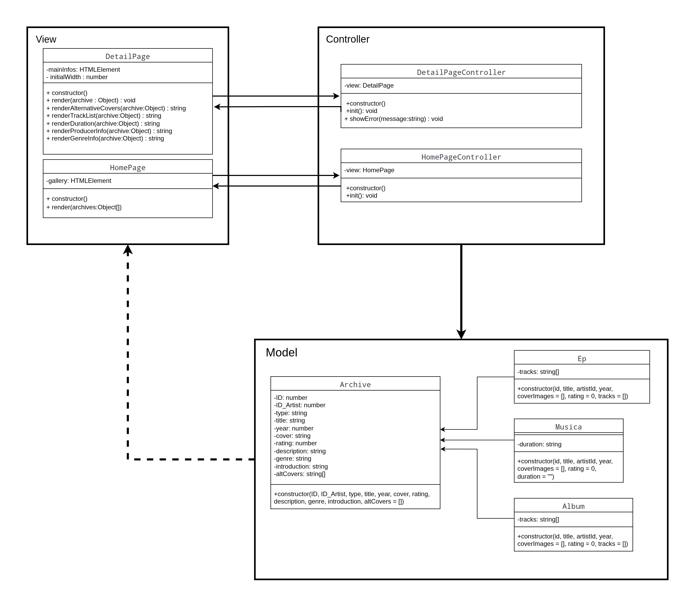
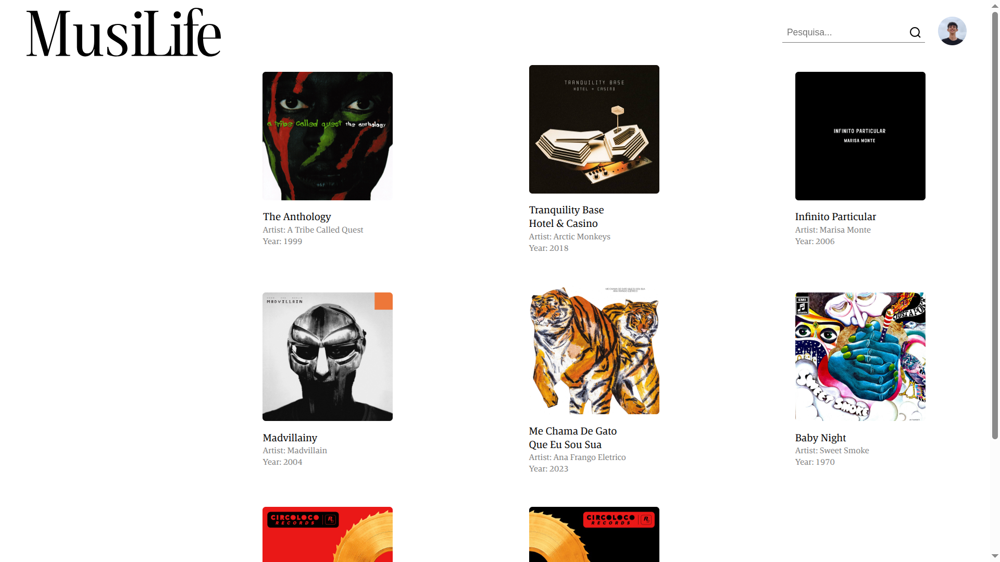
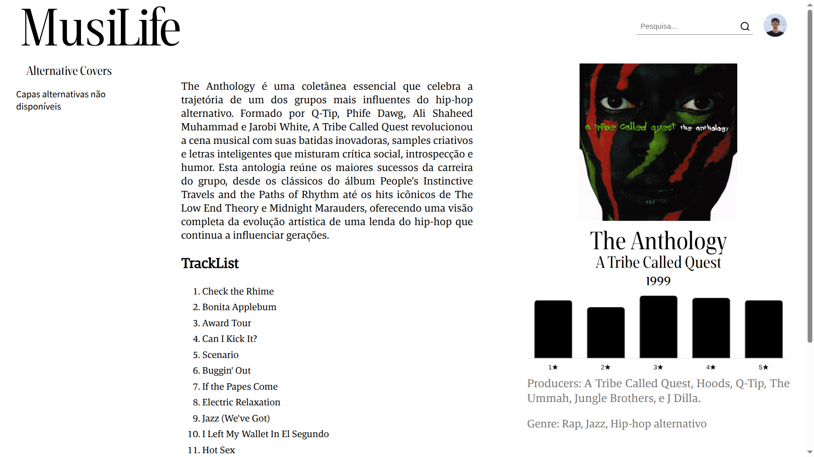
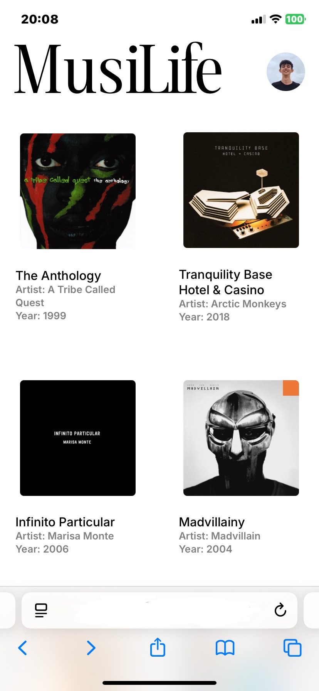
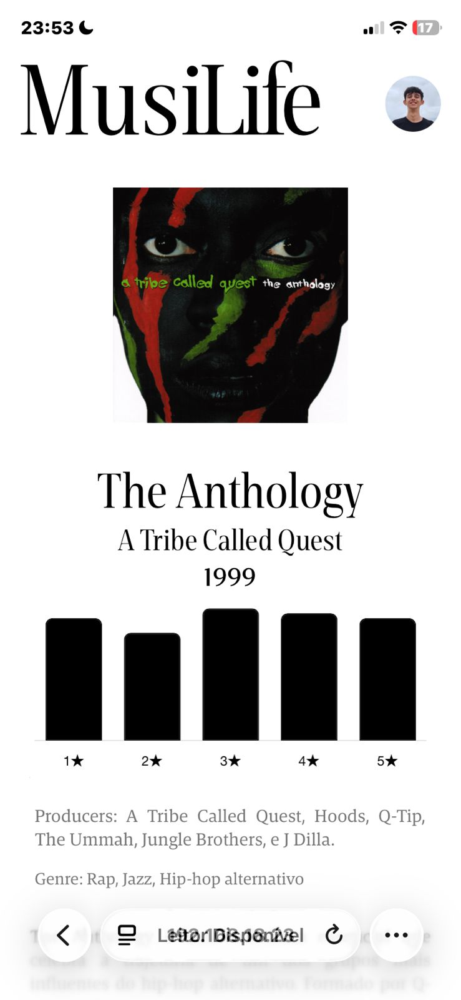
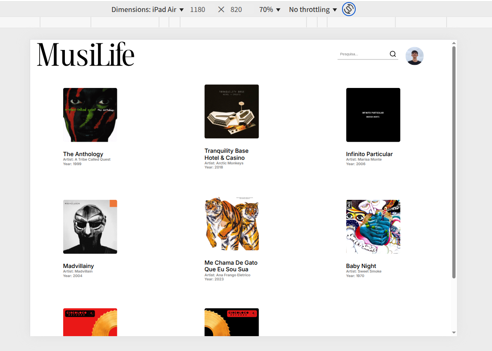
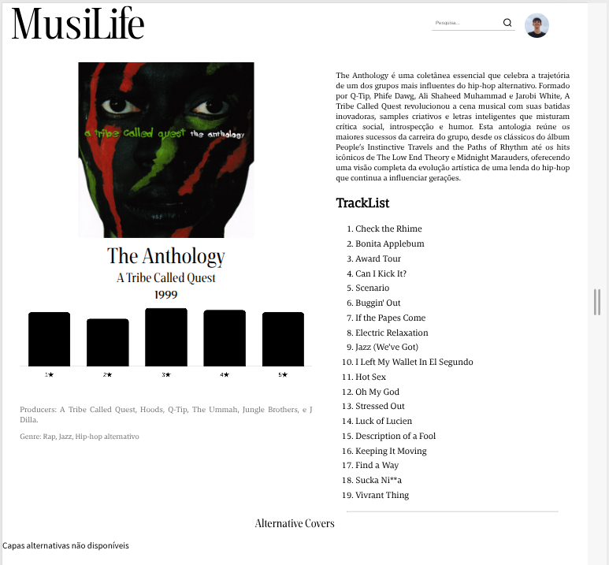

# Trabalho Prático - Semana 13 e 14

Para essa etapa, trabalharei na implementação de uma camada de acesso de dados juntamente com os objetivos das semanas 13 e 14.
A partir de agora, começarei a implementar um padrão de arquitetura divido em 3 camadas.
O padrão escolhido foi o MVC pois é muito utilizado e recomendado para aplicações WEB.
Se seguira de tal modo. Model tem uma classe pai chamada *ARCHIVE* que é todo documento que é aramazenado no banco e servirá de suprimento para o site.

NEW!
Para estas semanas, implementei uma camada a mais no programa, de acessod e dados.
DataAcces acesa diretamente o banco de dados, deslocando a função do model para um núcleo de trabalho a parte.
O incentivo para implementação dessa camada se deu à facilidade e reaproveitamenteo de codigo separando o CRUD básico em um núcleo a parte.
Esse "Núcleo" chamo de DataAcess.
O DataAcess opera na camada de acesso direto ao banco de dados, fazendo assim consultas à API do jsonServer.
Em suma, a adição de uma camada a mais traz: segurança ao codigo, uma vez que o model não acessa direto o banco de dados; Reaproveitamento, não é necessario para cada model escrever um trecho de codigo que realiza um CRUD.
Para cada caso a parte, o model pode tratar o dado como quiser, em sua classe, atraves do retorno do Acesso.

## Informações Gerais

- Nome:João Gabriel de Souza Bicalho
- Matricula: 898911
- Proposta de projeto escolhida: Coleções de itens.
- Breve descrição sobre seu projeto: Um site que tem um acervo de informações sobre as músicas.
  Você pode dar um feedback das músicas do acervo.

## Objetivos

1. Implementar um Chart(Gráfico) que mostra as avaliações de Albuns, Músicas e Eps do site.
2. Criar uma camada de acesso que reaproveita código.

## ATUALIZAÇÕES⚠️: *Implementação do padrão de projeto MVC V.2*.

O padrão de projeto MVC foi implementado ao projeto. As classes da View,
são responsáveis pelo conteudo exibido na tela. Crontroller atualiza a view
com os dados Model (Modelo).

A montagem da pagina de detalhes funciona da seguinte forma.

Monta-se o URL da página na query string:
> - type: Tipo de dado (Album, Ep, Musica) : default: *Archive*

> - id: identificador de *Archive*

Assim que o usuário clicar em um card, será direcionado para a página de detalhes 
do conteúdo clicado.

Diagrama Classes UML Arquitetura MVC V.2:

# Telas da Aplicação

A aplicação conta con tela responsiva em diferentes dispositivos. Apresentando um layout para cada aparelho.

## Tela PC 💻

  
  

## Tela Celular 📱

  
  

## Tela Tablet 📱

  
  
  

